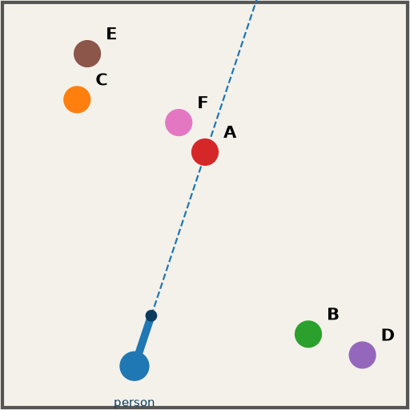

# "Bring me that one": can vision-language models follow a pointing gesture?

When people talk to a robot or an AR assistant, they often point and say *"that one"*. This pilot tests whether open
vision-language models (VLMs) can tell **which object a person is pointing at** in a simple top-down image, and
whether they follow the **direction** of the arm or just pick whatever is **close** to the hand.



## Design
- **96 procedurally generated scenes** (top-down, 10 x 10 m room): a person, their pointing arm, and 3 or 6 lettered
  objects. The ground truth is geometric: the object whose direction from the body is closest to the arm's direction.
- Varied: the **angle to the closest rival object** (8, 15, 30 degrees), **target distance** (2.5 m / 5.5 m) and
  **clutter** (3 / 6 objects). 8 random scenes per cell; a self-test checks every scene's ground truth and the rival
  angle before any model is called.
- **Three conditions** per scene:
  - `image`: the rendered scene only;
  - `image_ray`: the same scene with the arm's direction drawn as a dashed line (the system extends the gesture);
  - `text`: no image; the body, hand and object coordinates as numbers.
- **Models** (local, Ollama, temperature 0, seed 42): Gemma 4 12B, Qwen 3.5 9B, Gemma 3 12B. JSON answers, checked
  automatically. 864 answers in total.

## Results
| model | image | image + drawn ray | coordinates as text |
|---|---|---|---|
| Gemma 4 12B | 0.44 [0.33, 0.53] | **0.82** [0.74, 0.90] | 0.47 |
| Qwen 3.5 9B | 0.21 [0.14, 0.29] | **0.67** [0.57, 0.76] | 0.33 |
| Gemma 3 12B | 0.33 [0.24, 0.43] | **0.70** [0.60, 0.78] | 0.31 |

(95% bootstrap CIs. Chance is 0.33 with 3 objects and 0.17 with 6.)

1. **From the image alone, models barely follow pointing.** Accuracy is near what a simple shortcut gets.
2. **They use proximity, not direction.** When the target happens to be the object nearest the hand, Gemma 4 is right
   82% of the time; when it is not, only 23%. Most of its wrong answers are the object nearest the hand or body.
   So a model can look decent on easy scenes while not understanding the gesture at all.
3. **Drawing the ray fixes most of it** (+0.36 to +0.46 for every model; paired permutation test, Holm p < 0.001).
   With the ray, far targets become *easier* than near ones (Gemma 4: 0.92 far vs 0.73 near), the opposite of the
   image-only pattern, which again shows that without the ray they were using closeness.
4. **Numbers do not help either.** Given exact coordinates, models do no better than from the image (0.31 to 0.47):
   the geometry (extending a line and comparing angles) is the hard part, not seeing.
5. Remaining errors with the ray are mostly the rival object at the next-closest angle (72-76% of errors), i.e.
   honest near-misses rather than shortcuts.

Full tables: [`results/RESULTS.md`](results/RESULTS.md); figure: `results/fig_accuracy.png`; problems and decisions:
[`docs/RESEARCH_LOG.md`](docs/RESEARCH_LOG.md).

## What this suggests
Same lesson as our robot-intent and frame-of-reference studies: **don't ask the model to do the geometry; do it for
it.** A robot or AR system that already tracks the user's arm (from a headset or a body tracker) should compute the
pointing ray and give it to the model, rather than expect the model to infer it from pixels.

## Limitations
Top-down drawings, not photos or first-person views; one arm length; 8 scenes per cell; three models. A pilot that
shows a clear failure and a clear fix, not a benchmark.

## Run
```
python point_study.py selftest   # geometry checks, no model needed
python point_study.py render     # 96 scenes x 2 images -> data/img/
python point_study.py run        # needs Ollama with the three models
python point_study.py results    # tables, tests and figure -> results/
```
`run_all.sh` runs the study with `watchdog.py`, which logs GPU temperature and stops the (resumable) run at 84 C.

## Disclosure
Code and documentation were written with the help of an AI assistant; the research design, checking and decisions
are the author's.

## License
MIT
